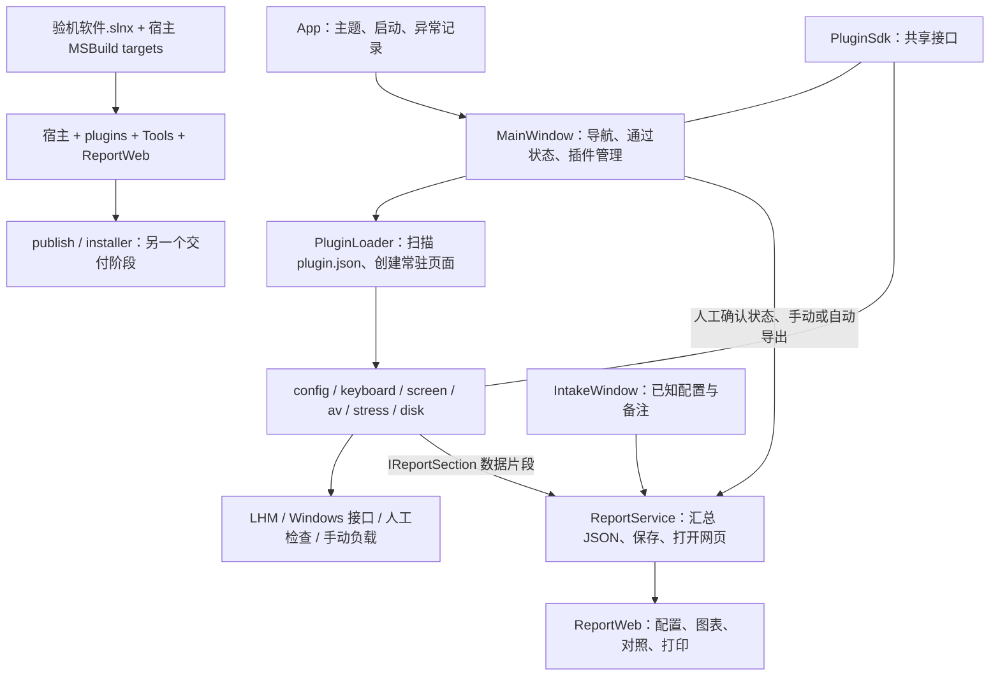

# 笔吧验机项目地图

代码结构记录于 2026-10-21，来源工作区为 `F:/BibaYanji-dev` 的 `feature/report-export` 分支，基于 `de110b9` 及当时的未提交改动。该记录不代表当前工作区状态；键盘标签切换仍待验证。

## 代码入口

| 层 | 入口 | 职责与边界 |
|---|---|---|
| 启动与宿主 | [App.xaml.cs](验机软件/App.xaml.cs)、[MainWindow.xaml.cs](验机软件/MainWindow.xaml.cs) | 插件页面常驻、导航、通过状态、登记与导出入口 |
| 插件加载 | [PluginLoader.cs](验机软件/Services/PluginLoader.cs)、[PluginPackageService.cs](验机软件/Services/PluginPackageService.cs) | 默认加载上下文、依赖解析、zip 导入和重启待办 |
| 共享契约 | [Contracts.cs](PluginSdk/Contracts.cs) | IYanJiPlugin / IModulePage / IKeyHandlerPage / IReportSection / IPluginShutdown / IHostContext；SDK 不引用 LHM |
| 配置核对 | [ConfigCheckPage.xaml.cs](Plugins/ConfigCheck/ConfigCheckPage.xaml.cs) | 现有 HardwareReport 映射为报告片段，不新增采集框架 |
| 键盘 | [KeyboardTestPage.xaml.cs](Plugins/KeyboardTest/KeyboardTestPage.xaml.cs) | 标准 ANSI 104 / 87 标签切换、按键反馈、人工确认；不区分物理设备 |
| 屏幕 | [DeadPixelPage.xaml.cs](Plugins/ScreenDeadPixel/DeadPixelPage.xaml.cs) | 全屏纯色、人工观察；报告记录确认状态，不生成坏点检测结论 |
| 影音 | [AvConferencePage.xaml.cs](Plugins/AvConference/AvConferencePage.xaml.cs)、[CameraService.cs](Plugins/AvConference/CameraService.cs) | 设备选择、预览/监听与释放；保留原有相机补丁，需真实设备验收 |
| 散热 | [StressTestPage.xaml.cs](Plugins/StressTest/StressTestPage.xaml.cs)、[SensorMonitorService.cs](Plugins/StressTest/SensorMonitorService.cs) | 已有监控和手动负载；导出最近一轮完整样本，空值保留为空 |
| 磁盘 | [DiskMarkPage.xaml.cs](Plugins/DiskMark/DiskMarkPage.xaml.cs)、[CdmService.cs](Plugins/DiskMark/CdmService.cs) | 本次成绩与历史成绩分开；跑分需手动启动 |
| LHM 生命周期 | [LhmComputerAccess.cs](Plugins/LhmComputerAccess.cs) | 配置与散热链接同份源码，以进程信号量管理 Open / 读取 / Close |
| 登记与报告 | [IntakeWindow.xaml.cs](验机软件/Views/IntakeWindow.xaml.cs)、[ReportService.cs](验机软件/Services/ReportService.cs) | 手工录入、模块数据汇总、保存 JSON 与网页；不自动认定配置一致 |
| 网页与接口 | [index.html](验机软件/ReportWeb/index.html)、[app.js](验机软件/ReportWeb/app.js)、[schema](验机软件/ReportWeb/inspection-summary.schema.json) | 原生 HTML / CSS / JS；biba-inspection-summary/1；示例和真实数据明确区分 |
| 主题 | [Light.xaml](验机软件/Themes/Light.xaml)、[Dark.xaml](验机软件/Themes/Dark.xaml)、[Controls.xaml](验机软件/Themes/Controls.xaml) | 构成主义深浅主题、动态语义资源、共用控件样式 |
| 构建 | [解决方案](验机软件.slnx)、[宿主工程](验机软件/验机软件.csproj) | BuildPlugins、CopyPluginsToOutput / Publish；插件不继承宿主自包含属性 |
| 封装与验收 | [build-release.ps1](installer/build-release.ps1)、[setup.iss](installer/setup.iss)、[VerifyRelease.cs](installer/VerifyRelease.cs) | 独立于源码检查；硬件验收入口会操作实际设备，需单独安排 |

## 报告功能检查项

1. 插件 → JSON → 网页的数据链路完整；缺失数据不代表通过。
2. 自动报告每个完成周期只打开一次，状态回退后可重新完成，失败可重试。
3. 104 / 87 键标签切换后，按键记录、进度和通过状态保持一致。
4. 登记、配置对照、深浅主题、分类动画及网页打包资源分别检查。
5. 构建与行为验证分别记录结果和未验证项；已有未提交改动不得覆盖。

## 验证与历史边界

- 项目地图只描述结构，不证明当前版本构建通过；历史构建和探针不能替代当前验证。
- 真实数据来自现有插件；页面人工确认不等于自动判定合格，报告功能不新增 AI / OCR / Java 引擎。
- 相机实际画面、声音效果、物理按键、坏点观察需要设备与人工确认。
- 历史三小时监控失败记录保留；短测不替代耐久验收。烤机、磁盘负载及驱动安装/重装均需单独安排，不自动启动。
- 安装包、公开发行、合并与源码修改分阶段处理；源码更新不表示既有预览包已更新。
- 2026-10-19 的 Word 交接文档保留为历史资料，其中的工作区状态不作为当前改动清单。
